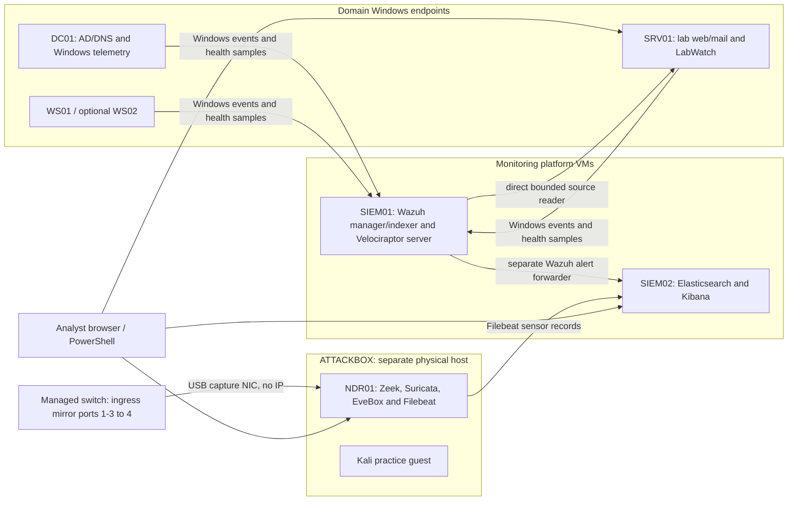

# Architecture

Names describe lab roles, not Internet-exposed services. Software versions and historical acceptance are in the validation record; this drawing is not a guarantee every machine is running at every moment.

LabWatch consumes Wazuh independently of Elastic. It keeps incidents, evidence, knowledge and audit history; an Elasticsearch document count is not an incident count. Normal promotion is level 9 or above plus explicitly selected lower-level exceptions, with existing exclusions and bounded grouping.

NDR01's management NIC and passive USB capture NIC serve different purposes. A same-hypervisor conversation can bypass the physical switch mirror. A marked ATTACKBOX-to-SRV01 request exercises the physical observation path; an ordinary 404 response still establishes an HTTP response.

Wazuh is the alert source. Elastic provides search/correlation. EveBox displays Suricata events and alerts, not Zeek. Velociraptor supplies separately scoped endpoint investigation. Splunk is retired; preserved historical imports are not a complete copy of every old source.

Windows/Pacific display time and UTC sensor time must be normalized by offset. A URL marker identifies an action, Zeek uid joins native Zeek records, and Community ID identifies a network flow across sensor datasets. None is a username or a case number.
